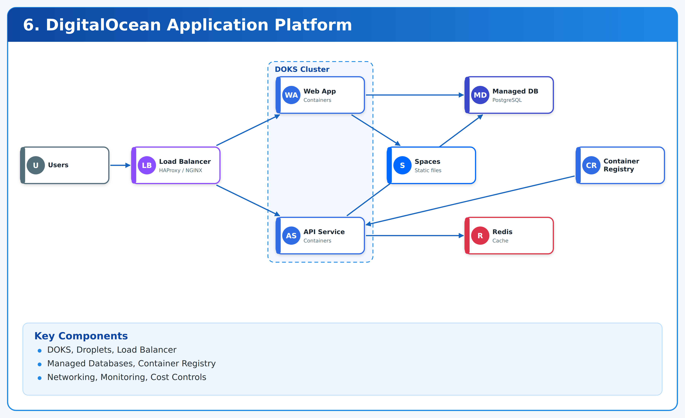
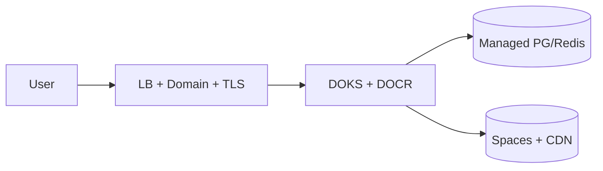

# 06. DigitalOcean Production Application Platform



**DigitalOcean · DOKS · Managed DBs** · *low-cost production path* · `lab`.

> DOKS + DOCR + managed Postgres/Redis + Spaces + LB + TLS. Cheapest credible production for side projects.

## Contents

1. Outcomes 2. Architecture 3. Prerequisites 4. Repo map 5. Step 0 clone 6. Step 1 local Docker run 7. Step 2 doctl auth 8. Step 3 Terraform provision 9. Step 4 DOCR push + deploy 10. Step 5 verify + TLS 11. CI/CD 12. Cost/teardown 13. Troubleshooting

## 1. Outcomes

- Containerized Node app `app/server.js` + `Dockerfile` deployable to DOKS or Droplet.
- Terraform `terraform/main.tf` for VPC/DOKS/DOCR/DB/Spaces/domain (fill per need).
- Budgets + spaces lifecycle + DB backup retention.

## 2. Architecture



## 3. Prerequisites

- docker, doctl (`brew install doctl`), kubectl, helm, terraform.
- DO account + token with read/write. Domain optional first run.

## 4. Repository map

```
app/server.js      # http ok on 8000
app/Dockerfile     # node:20-alpine
terraform/main.tf  # DO provider, region blr1 default
```

## Step 0 — Clone

```bash
git clone https://github.com/navin-kumar10/digitalocean-production-app-platform.git
cd digitalocean-production-app-platform
bash tests/smoke.sh
cat app/server.js app/Dockerfile terraform/main.tf
```

## Step 1 — Run locally (zero DO)

```bash
docker build -t do-app:dev ./app
docker run -d -p 8000:8000 --name doapp do-app:dev
curl -s http://localhost:8000/; echo
docker logs doapp --tail 5
docker stop doapp && docker rm doapp
# without docker:
node app/server.js & curl -s http://localhost:8000/; kill %1
```

## Step 2 — Auth to DigitalOcean

```bash
doctl auth init
doctl account get
export DIGITALOCEAN_TOKEN=$(grep -o 'access-token.*' ~/.config/doctl/config.yaml | head -1)
doctl compute region list | head -10
```

Never commit token (`.gitignore` covers `.env`).

## Step 3 — Provision (fill then apply)

```bash
cat terraform/main.tf
# extend with: VPC, DOKS (1-2 nodes smallest), DOCR, managed PG (db-s-1vcpu-1gb), Spaces, domain
terraform -chdir=terraform init
terraform -chdir=terraform fmt -check
terraform -chdir=terraform validate
terraform -chdir=terraform plan -out=tfplan
# review LB + DB + nodes — these bill hourly
terraform -chdir=terraform apply tfplan
doctl kubernetes cluster kubeconfig save lab 2>&1 | head -3 || echo "after cluster exists"
```

Keep dev to 1 node pool × 1-2 basic nodes; destroy nightly.

## Step 4 — Push image and deploy

```bash
doctl registry create lab-reg 2>&1 | head -2 || true
doctl registry login
docker tag do-app:dev registry.digitalocean.com/lab-reg/do-app:v0.1.0
docker push registry.digitalocean.com/lab-reg/do-app:v0.1.0
kubectl create deployment do-app --image=registry.digitalocean.com/lab-reg/do-app:v0.1.0 --port=8000
kubectl expose deploy do-app --port=80 --target-port=8000
kubectl rollout status deploy/do-app
```

Ingress + cert-manager for TLS per Project 03 pattern.

## Step 5 — Verify

```bash
kubectl get pods,svc
kubectl port-forward svc/do-app 8080:80 &
curl -s http://localhost:8080/; echo
kill %1
doctl databases list 2>&1 | head -5 || echo "db when provisioned"
```

## CI/CD

Use Project 04 reusable workflow: build → Trivy → push DOCR → staging `kubectl set image` → smoke → approval → prod.

## Cost and teardown

```bash
kubectl delete deploy,svc do-app 2>/dev/null || true
terraform -chdir=terraform destroy
doctl compute droplet list; doctl kubernetes cluster list; doctl databases list
# delete leftover LB/volumes/snapshots in panel
```

Drivers: nodes + LB + managed DB + Spaces. Smallest sizes, lifecycle, backup retention 7d lab.

## Troubleshooting

| Symptom | Cause | Fix |
|---|---|---|
| `unauthorized` doctl | token missing | `doctl auth init` |
| ImagePullBackOff on DOKS | DOCR auth | `doctl registry kubernetes-manifest | kubectl apply -f -` |
| High bill | LB/DB left on | destroy + panel check |

MIT — LICENSE.
